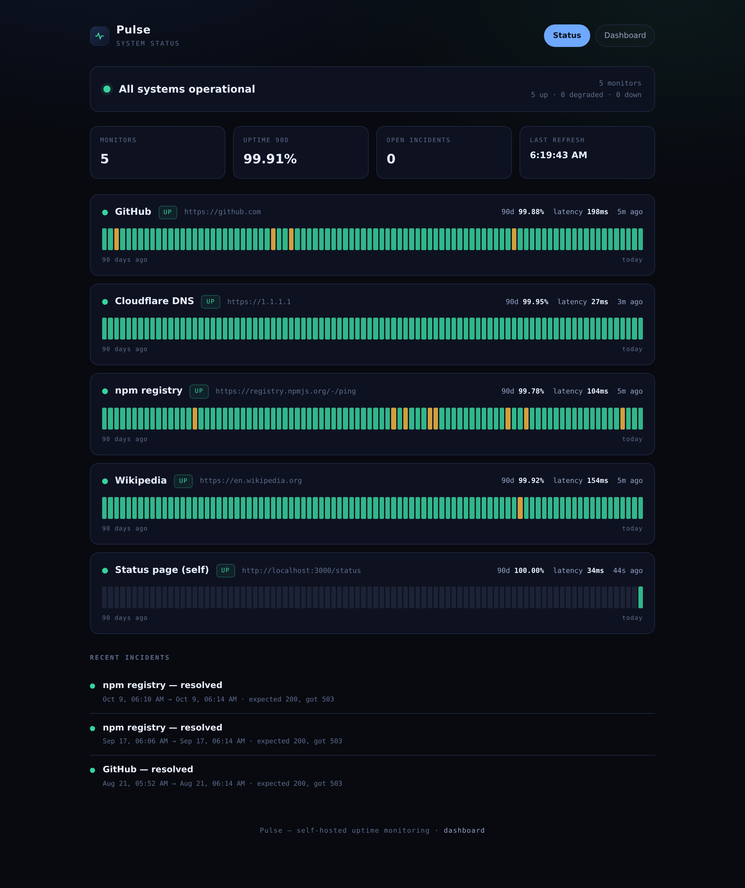

<div align="center">

# Pulse

**Self-hosted uptime monitoring that fits in one container, one file of SQLite, and one `docker compose up`.**

[](https://github.com/Nanikumar4568/pulse/actions/workflows/ci.yml)
[](#testing)
[](#requirements)
[](LICENSE)



</div>

Pulse probes your services on their own schedules, stores every check, rolls them into 90-day
uptime bars, tracks incidents from first failure to recovery, and publishes a status page your
users can read without a login.

There is no SaaS account, no Postgres, no Redis, no queue, and no background worker process.
The scheduler runs inside the server, the database is a single SQLite file, and the whole thing
is three direct runtime dependencies deep.

---

## Quick start

```bash
git clone https://github.com/Nanikumar4568/pulse.git
cd pulse
docker compose up -d
open http://localhost:3000
```

That is the whole install. The dashboard is at `/`, the public status page at `/status`.

To start with a populated demo instead of an empty one:

```yaml
# compose.yaml
environment:
  SEED_ON_START: "1"
```

```bash
docker compose up -d
```

### Without Docker

```bash
npm ci
npm run dev          # http://localhost:3000, reloads on change
```

```bash
npm run build && npm start   # production
npm run seed                 # optional: 90 days of demo history
```

---

## What it does

| | |
|---|---|
| **Cron-style checks** | Each monitor carries its own interval (30 s – 24 h). A monitor is due when its own interval has elapsed since its last check, so nothing drifts and nothing bunches up. |
| **Latency history** | Every probe records status code, wall-clock latency, and the error cause. Nothing is sampled away. |
| **90-day uptime bars** | Checks roll into fixed-width UTC day buckets: one bar per day, always exactly 90 bars, never a gap. |
| **Incident timeline** | A run of failures opens **one** incident, not one per failed check. The next success resolves it. |
| **Public status page** | `/status` is read-only, needs no auth, and answers "is it down?" in one glance. |
| **Admin dashboard** | `/` adds, pauses, resumes, deletes, and force-checks monitors. |
| **Webhook alerts** | Opening and resolving an incident POSTs a JSON payload to `WEBHOOK_URL`. Delivery is fire-and-forget, retried with backoff, and can never slow down or fail a check. |

### States

| State | Meaning |
|---|---|
| `up` | last check passed, 24 h uptime ≥ 99.5 % |
| `degraded` | last check passed, 24 h uptime between 90 % and 99.5 % |
| `down` | the most recent check failed |
| `nodata` | never checked, or the monitor is paused |

A fleet is only as healthy as its worst monitor — one `down` service makes the banner say so.

---

## Adding monitors

Through the dashboard, or with the API:

```bash
curl -X POST localhost:3000/api/monitors \
  -H 'content-type: application/json' \
  -d '{
    "name": "API gateway",
    "url": "https://api.example.com/health",
    "expectStatus": 200,
    "intervalS": 60,
    "timeoutMs": 10000
  }'
```

| Field | Default | Rules |
|---|---|---|
| `name` | required | 1–80 characters |
| `url` | required | absolute `http:` or `https:` URL |
| `method` | `GET` | `GET` or `HEAD` |
| `expectStatus` | `200` | integer 100–599 |
| `intervalS` | `60` | integer 30–86400 |
| `timeoutMs` | `10000` | integer 1000–60000 |

Validation failures return `422` with every offending field:

```json
{
  "error": "validation failed",
  "errors": [{ "field": "url", "message": "url must be an absolute http(s) URL" }]
}
```

---

## API

| Method | Path | Purpose |
|---|---|---|
| `GET` | `/api/health` | liveness + process uptime |
| `GET` | `/api/summary` | fleet state, counts, recent incidents |
| `GET` | `/api/monitors` | every monitor with its current status |
| `POST` | `/api/monitors` | create |
| `GET` | `/api/monitors/:id` | one monitor's status |
| `PATCH` | `/api/monitors/:id` | rename, re-point, re-interval, pause/resume |
| `DELETE` | `/api/monitors/:id` | remove, cascading its history |
| `POST` | `/api/monitors/:id/check` | force an immediate probe |
| `GET` | `/api/monitors/:id/history?days=90` | day buckets + the 60 most recent checks |
| `POST` | `/api/preview` | test a URL before you commit to monitoring it |
| `GET` | `/api/scheduler` | ticks and checks run this session |

Reads are always public. Mutations require an `x-admin-token` header **only if** `ADMIN_TOKEN`
is set, so a single-user instance needs no auth while an exposed one can be locked down.

---

## Configuration

| Variable | Default | Purpose |
|---|---|---|
| `PORT` | `3000` | listen port |
| `HOST` | `0.0.0.0` | bind address |
| `DB_PATH` | `pulse.db` | SQLite file; `/data/pulse.db` in the image |
| `TICK_MS` | `5000` | how often the scheduler looks for due monitors |
| `ADMIN_TOKEN` | unset | when set, mutations require this token |
| `WEBHOOK_URL` | unset | POST incident open/resolve events here |
| `SEED_ON_START` | `0` | container only: seed demo history if the database is empty |

---

## Architecture

```
src/
  index.ts            process wiring: db, app, scheduler, signals
  app.ts              Fastify instance, static files, error handler
  routes/api.ts       HTTP surface
  core/
    checker.ts        one probe: fetch + timeout + status compare, never throws
    scheduler.ts      injectable-clock tick loop, per-monitor due logic
    monitor.ts        MonitorStore: persistence, incidents, status derivation
    notifier.ts       webhook delivery: retries, timeouts, never blocks a check
    uptime.ts         pure functions: percentages, day buckets, worst-state
    types.ts          shared shapes
  db/
    index.ts          openDb + runMigrations
    migrations.ts     ordered, versioned schema
public/
  index.html          dashboard        app.js      (~7 KB, no framework)
  status.html         public page      status.js   (~5 KB, no framework)
tests/                112 tests across 6 files
```

**The scheduler is not a cron daemon.** It wakes on `TICK_MS`, asks the store which monitors are
due, and probes them in parallel with `Promise.allSettled`. A monitor that is slow or broken
cannot delay the others, and a tick that is still running blocks the next one from stacking on
top of it. The clock is injectable, so the whole thing is tested without waiting on real time.

**The checker never throws.** Timeouts go through `AbortController`, the response body is always
drained, and undici's wrapped `cause` is unwrapped into a message a human can act on. A failed
DNS lookup becomes a recorded failed check, not a crashed scheduler.

**Migrations are the schema.** There is no `CREATE TABLE` scattered through the code. Versioned
migrations run in order inside a transaction and are recorded in `schema_version`, so an existing
database upgrades in place and running the same migration twice is a no-op.

**Incidents are derived state, not events.** Recording a check opens an incident only when one
isn't already open and resolves it on the next success. That is what keeps an hour-long outage
to one row in the timeline instead of sixty.

### Why SQLite, and why `better-sqlite3`

An uptime monitor writes a handful of rows a minute. Postgres would be more moving parts than
the workload justifies, and a file makes backup a `cp`. `better-sqlite3` is synchronous, so
there is no async driver to desynchronise from an async HTTP server, and WAL mode plus
`foreign_keys = ON` are set on every connection.

### Why no frontend framework

The two pages are about 12 KB of plain JavaScript and one stylesheet. There is no build step, no
hydration, and nothing between the markup and the DOM. The result is a page that loads instantly
on a Raspberry Pi and cannot break because a transitive dependency shipped a bad release.

---

## Testing

```bash
npm test              # 125 tests, ~2 s
npm run test:coverage
npm run typecheck
```

```
tests/uptime.test.ts       26   percentage thresholds, UTC day buckets, empty input
tests/checker.test.ts      10   status match, timeouts, aborts, thrown errors, DNS causes
tests/monitor.test.ts      37   CRUD, validation, incident lifecycle, 24 h window edges
tests/notifier.test.ts      6   payload shape, retry/backoff, non-blocking, crash safety
tests/migrations.test.ts    7   fresh apply, idempotency, FK enforcement, cascade
tests/scheduler.test.ts    14   due logic, parallelism, overlap guard, isolation
tests/api.test.ts          25   real Fastify against a real temp database
```

Tests run against real SQLite databases and a real Fastify instance via `app.inject` — the only
things stubbed are `fetch` and the clock. Every request in `api.test.ts` goes through the full
routing, validation, and persistence path.

Three bugs in this codebase were found by testing and fixed before release:

- a paused monitor kept reporting the last check's state instead of `nodata`;
- a bodyless `POST` from the dashboard sent `content-type: application/json`, which Fastify
  correctly rejects — the client now only declares a body when it has one;
- two overlapping refreshes could paint out of order and overwrite fresher data with stale,
  which the dashboard now prevents with a render sequence guard.

---

## Webhook alerts

Set `WEBHOOK_URL` and Pulse posts one message when an incident opens and one when it resolves:

```json
{
  "event": "incident.opened",
  "monitorId": 1,
  "monitorName": "API gateway",
  "url": "https://api.example.com/health",
  "at": "2026-03-01T12:00:00.000Z",
  "reason": "expected 200, got 503"
}
```

```json
{
  "event": "incident.resolved",
  "monitorId": 1,
  "monitorName": "API gateway",
  "url": "https://api.example.com/health",
  "at": "2026-03-01T12:04:30.000Z",
  "durationS": 270
}
```

Delivery is queued, never awaited by the check that caused it, and retried three times with
exponential backoff. A webhook that is down logs a warning and changes nothing else — the
incident is already committed to the database before the first attempt is made, so a rolled-back
check can never produce a notification and a failed notification can never lose an incident.

```yaml
# compose.yaml
environment:
  WEBHOOK_URL: https://hooks.slack.com/services/...
```

---

## Operations

- **Health check**: `GET /api/health`, wired into the image's `HEALTHCHECK` and Compose.
- **Backup**: copy `/data/pulse.db` (or `sqlite3 pulse.db ".backup backup.db"` while running).
- **Data**: one volume, `pulse-data`. Deleting it starts from an empty dashboard.
- **Image**: built and published to GHCR by CI on every push to `main` and every `v*` tag,
  tagged `latest`, `sha-<short>`, and semver when tagged.
- **Security**: the image runs as the unprivileged `node` user; `npm audit` reports
  **0 vulnerabilities** across the whole dependency tree.

### Docker

```bash
docker build -t pulse .
docker run -p 3000:3000 -v pulse-data:/data pulse
```

---

## Requirements

- Node **≥ 22** (also verified on 24)
- Docker with Compose v2 for the container path
- SQLite ≥ 3.35 (bundled with `better-sqlite3`; no system package needed)

---

## Demo data

`npm run seed` writes 90 days of synthetic history for four real public endpoints so a fresh
install has something to look at. Those rows are generated, not observed — the dashboard and
status page show them exactly as they would show real checks, and incidents in that window are
synthetic too. Any check written by the scheduler afterwards is a genuine network probe, and the
`Status page (self)` monitor is always real: it hits this instance's own `/status`.

Nothing in the application marks seeded checks as demo data. If you deploy a public instance,
start from an empty database and do not run the seed.

---

## License

MIT — see [LICENSE](LICENSE).
